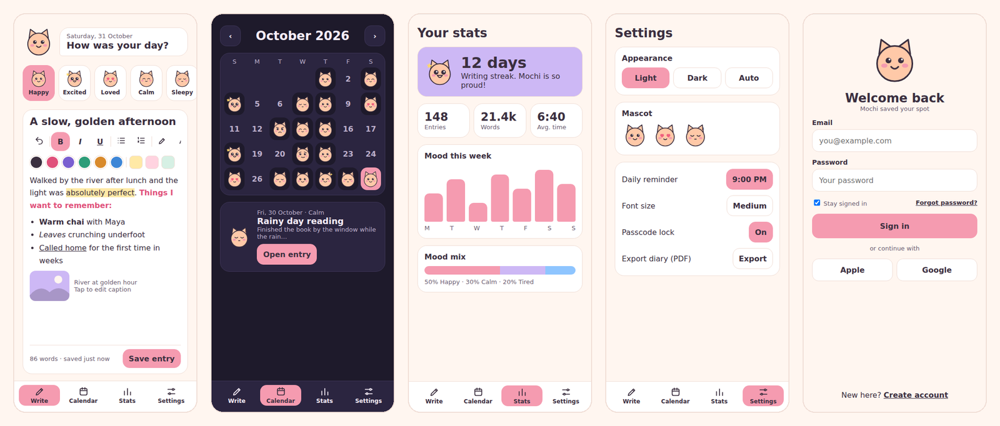
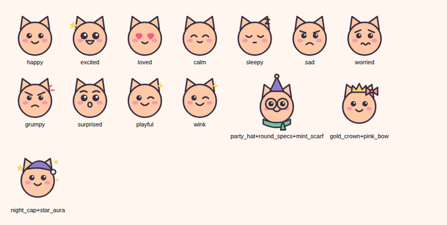

<div align="center">


# Pawsie Diary

**A cosy, private diary for Android, kept company by Mochi the cat.**

Write rich-text entries with photos, track your mood, build streaks, unlock outfits for Mochi,
and keep everything encrypted on your phone, with optional end-to-end encrypted cloud backup.




</div>

---

## Contents

- [Features](#features)
- [Meet Mochi](#meet-mochi)
- [Quick start](#quick-start)
- [Turning on the online features (optional)](#turning-on-the-online-features-optional)
- [Privacy and security](#privacy-and-security)
- [How sync works](#how-sync-works)
- [How reminders work](#how-reminders-work)
- [Project structure](#project-structure)
- [Tech stack](#tech-stack)
- [Tests and quality](#tests-and-quality)
- [Troubleshooting](#troubleshooting)
- [Known limits](#known-limits)
- [Author](#author)

---

## Features

### Writing
- **Rich text** written with a custom editor: bold, italic, underline, bullet lists, numbered lists
  (Enter continues a list, Enter on an empty item ends it), 5 text colours, 3 highlight colours, and undo.
  Formatting is saved with each entry.
- **Inline photos** from the camera or gallery (up to 10 per entry), placed right at your cursor. Tap a photo to zoom.
- **10 moods**, each with its own Mochi face, plus **Mochi stickers** to decorate an entry.
- The header and mood row tuck away while you type so the toolbar fits above the keyboard.

### Looking back
- **Calendar** showing Mochi's mood face on every day you wrote, with entries listed below.
- **Stats**: current streak, entries, words, average writing time, a "mood this week" chart and a mood mix bar.
- **"One year ago today"** memories in your reminders.

### Playful rewards
- **8 achievements** with progress bars (First page, 7-day streak, Night owl, 100 entries, Wordsmith,
  30-day streak, Mood rainbow, Full year).
- Each unlocks a **wardrobe** item for Mochi: hats, glasses, a scarf, a bow, a crown, a star aura and a Garden theme.
- **5 colour themes** (Pawsie, Lavender, Peach, Ocean, Garden), each in light and dark, plus Light / Dark / Auto mode and three font sizes.

### Privacy and safety
- Entries and photos are **encrypted on the device** (AES-256-GCM, key held by the Android Keystore).
- **4-digit passcode** lock that re-locks when the app goes to the background, with **fingerprint / face unlock**.
- Signing out **wipes the diary from the phone** (after a safety upload if cloud backup is on).

### Reminders, export and backup
- **Daily reminder** notifications styled with Mochi artwork and a "Write now" button.
- **PDF export** of the whole diary: formatting, photos and mood icons included, with Hindi and other scripts supported.
- Optional **Google / Apple sign-in**, **password reset email** and **end-to-end encrypted cloud backup with live sync**.

---

## Meet Mochi

Mochi is drawn as SVG and assembled at runtime from a base head, a face for each mood and optional accessories,
so every mood and outfit combination comes from the same few pieces of artwork.

<div align="center">

</div>

---

## Quick start

**You need:** Flutter **3.38 or newer**, Android Studio (or the Android SDK), and an Android phone or an
emulator image **with Google Play** (the encryption key needs the Android Keystore).

```bash
# 1. get the code, then from the project folder:
flutter create --platforms=android --org com.example --project-name pawsie_diary .
flutter pub get

# 2. patch the generated Android project (notifications, fingerprint, icons). Safe to re-run.
dart tool/setup_android.dart

# 3. run it
flutter run --release
```

Notes:

- `flutter create .` only adds the missing `android/` folder. It leaves `lib/` alone. If you already have an
  `android/` folder you can skip it.
- `tool/setup_android.dart` edits `AndroidManifest.xml` (notification receivers, permissions, auto-backup off),
  `MainActivity` (fingerprint support), the launch theme, `build.gradle` (desugaring) and installs Mochi's app icon.
  **Skip it and reminders and fingerprint unlock will not work.**
- Use `--release` to judge speed. Debug builds on an emulator are many times slower than the real app.
- The first launch needs internet once (Quicksand font; the PDF export also downloads a font the first time).

The app works fully offline with no setup beyond this. Firebase is only for the online extras below.

---

## Turning on the online features (optional)

Until you do this, the Google / Apple buttons and cloud backup simply explain that online features are off.

1. Create a project at the [Firebase console](https://console.firebase.google.com).
2. **Authentication > Sign-in method:** enable **Email/Password** and **Google**.
   (Apple needs a paid Apple Developer account and a Services ID, so skip it if you do not have one.)
3. **Firestore Database:** create it, then use these rules:

   ```
   rules_version = '2';
   service cloud.firestore {
     match /databases/{db}/documents {
       match /users/{uid}/{document=**} {
         allow read, write: if request.auth != null && request.auth.uid == uid;
       }
     }
   }
   ```

4. **Project settings > Your apps > Android:** add the **SHA-1 and SHA-256** of your debug key
   (Android Studio: Gradle tab > `android` > Tasks > `signingReport`), then download `google-services.json`
   into `android/app/`. The native Google account picker needs both fingerprints.
5. Connect the app. This replaces `lib/firebase_options.dart`:

   ```bash
   dart pub global activate flutterfire_cli
   flutterfire configure --platforms=android
   ```

6. If Google sign-in says *"serverClientId must be provided"*, paste your **Web client ID**
   (Authentication > Sign-in method > Google > Web SDK configuration) into `kGoogleWebClientId` in `lib/cloud.dart`.

Then open **Settings > Cloud backup > Turn on backup** and choose a backup passphrase.

---

## Privacy and security

| What | Where it lives | How it is protected |
| --- | --- | --- |
| Entries and photos | App storage on the phone | AES-256-GCM. The random 256-bit key is stored in the Android Keystore via `flutter_secure_storage`, never in the app's own files. Large payloads are encrypted on a background isolate. |
| Account password (on device) | App storage | Salted SHA-256 hash. The plain password is never stored. |
| Passcode | App storage | Salted SHA-256 hash. It gates the app screen; the data itself is protected by the Keystore key. |
| Cloud backup | Firebase Firestore | Encrypted **on the phone** with AES-256-GCM using a key derived from your passphrase (PBKDF2-HMAC-SHA256, 100,000 rounds). Firebase stores only ciphertext, a random salt, a passphrase check value, and entry ids with timestamps. |
| Photos in the cloud | Not uploaded | Kept on the phone only (see [Known limits](#known-limits)). |
| Android auto-backup | Switched off | The Keystore key cannot move to another phone, so a restored copy of the files would be unreadable. |

**Important:** the diary is tied to the phone's Keystore. If you clear the app's data or uninstall, the local entries are gone.
Turn on cloud backup (and keep your passphrase safe) or export a PDF first. **If you forget the backup passphrase, the backup cannot be recovered**,
because only you hold the key.

---

## How sync works

With cloud backup on, sync is automatic:

- A **live Firestore listener** pulls changes from your other devices within seconds.
- A **full sync** runs when the app opens or returns to the front (at most every 30 seconds).
- Saving an entry uploads it straight away. **Deleting** an entry leaves a small "deleted" marker, so your other devices remove it too and it does not come back.
- **Conflicts:** the newest edit of each entry wins.
- **New phone:** sign in, and the app offers *"Restore your diary?"* when it finds a backup. Enter your passphrase and your entries return.
- **Signing out** uploads everything first (if backup is on), then removes the diary from the phone.

---

## How reminders work

- Turn on **Daily reminder** in Settings and pick a time. Android asks for notification permission.
- The next **14 evenings** are scheduled as one-off notifications, and rebuilt whenever you open the app or save an entry.
  A night you already wrote is skipped.
- Messages change: a normal nudge, a **streak** message ("Your 12-day streak is waiting"), or **"One year ago today"**
  when you wrote on this date before. Each has Mochi artwork and a **Write now** button.
- **Exact timing:** on Android 13 and newer, alarms are "approximate" by default and can arrive late.
  Settings shows an **Exact timing > Allow** switch that opens Android's "Alarms and reminders" screen.
- Scheduled reminders need two receivers in the manifest. `dart tool/setup_android.dart` adds them.
- Developer aid: long-press **Daily reminder** in Settings to see whether notifications are allowed, how many are queued, and the last error.

---

## Project structure

```
lib/
  main.dart            Boot screen, lifecycle (lock on pause, sync on resume), sign-in / lock gate
  state.dart           AppState: account, entries, settings, passcode, photos, cached stats
  models.dart          Moods, Entry, stats, achievements, rewards
  vault.dart           AES-GCM encryption, Keystore key, passphrase key derivation
  cloud.dart           Firebase sign-in, encrypted backup, live sync, delete markers
  auth.dart            Sign in / create account, Google and Apple, forgot password
  lock.dart            Passcode screen, passcode setup, fingerprint prompt
  biometric.dart       Fingerprint / face check
  home.dart            Tab shell with the animated nav bar
  write.dart           Entry editor: moods, photos, stickers, save and badge pop-ups
  rich.dart            Custom rich-text engine (per-character formatting) and toolbar
  secure_image.dart    Shows encrypted photos, full-screen zoom
  calendar.dart        Month grid with mood faces
  stats.dart           Streak, totals, weekly mood chart, mood mix
  achievements.dart    Badge grid with progress
  wardrobe.dart        Dress Mochi up with unlocked rewards
  settings.dart        Appearance, theme, reminders, security, export, cloud, sign out
  brand_links.dart     GitHub and LeetCode link cards
  reminders.dart       Notification scheduling and styling
  pdf_export.dart      PDF generation
  mochi.dart           Builds Mochi from SVG pieces
  mochi_art.dart       Generated artwork data (faces, accessories)
  notif_art.dart       Generated Mochi images used in notifications
  theme.dart           Colour tokens, five themes, ThemeData cache
  widgets.dart         Shared buttons, cards, nav bar, inputs
  dialogs.dart         Passphrase dialog
  utils.dart           Date helpers
  firebase_options.dart  Placeholder; replaced by `flutterfire configure`
tool/
  setup_android.dart   Patches the generated Android project (safe to re-run)
  android_res/         Launcher icons and notification icon
test/
  widget_test.dart     Unit tests
docs/screenshots/      README images
```

**Design notes**

- **No state-management package.** One global `AppState` (a `ChangeNotifier`) plus `ListenableBuilder`s keeps the app small and easy to follow.
- **Lazy tabs.** Only the open tab is built; the Write tab stays alive so a half-written entry is never lost.
- **Cached work.** The theme and the stats are computed once per change instead of on every rebuild.
- **Custom editor.** Each character carries its own formatting; it is saved as run-length-encoded runs, and photos are placeholder characters in the text.

---

## Tech stack

| Area | Packages |
| --- | --- |
| UI and art | Flutter, `flutter_svg`, `google_fonts` (Quicksand) |
| Storage | `shared_preferences`, `path_provider`, `image_picker` |
| Encryption | `cryptography` (AES-GCM, PBKDF2), `flutter_secure_storage`, `crypto` |
| Lock | `local_auth` |
| Notifications | `flutter_local_notifications`, `timezone` |
| PDF | `pdf`, `printing` |
| Online (optional) | `firebase_core`, `firebase_auth`, `cloud_firestore`, `google_sign_in` |
| Links | `url_launcher` |

---

## Tests and quality

```bash
flutter test      # word counting, streaks and badges, entry JSON round trip
flutter analyze   # should show no errors
```

The rich-text engine (formatting, lists, undo, inline photos) was also exercised with a separate logic harness during development.
There is no automated UI or on-device test suite yet.

---

## Troubleshooting

| Problem | Fix |
| --- | --- |
| Scheduled reminders never appear, though "show now" works | The manifest is missing the notification receivers. Run `dart tool/setup_android.dart`, then stop the app and run it again (not hot reload). Turn on **Exact timing**. Long-press **Daily reminder** for a status line. |
| `flutter analyze` shows lots of errors from files you did not write | Old code or stray `.dart` files from another app are in the project. Delete them, and any loose `.dart` file next to `pubspec.yaml`. |
| Red `_dependents.isEmpty` error screen | Usually a leftover after hot reload following a big change. Stop the app and run it fresh. |
| "Could not open its secure storage" | Use an emulator image with Google Play, or a real phone. This can also appear if app data was restored onto a different phone. |
| Google sign-in cancels right after you pick an account | The SHA-1 and SHA-256 of your build are missing in Firebase, or `google-services.json` is out of date. |
| "serverClientId must be provided" | Set `kGoogleWebClientId` in `lib/cloud.dart`. |
| "Sync failed" or permission denied | Create the Firestore database and apply the rules above. |
| Diary empty after clearing app data | Sign in again and enter your backup passphrase when asked to restore. |
| App feels slow on an emulator | Run with `flutter run --release`, or use a real phone. |

---

## Known limits

- **Android only.** iOS and web are not set up.
- **Photos are not backed up** to the cloud (that needs Firebase Storage on a paid plan). Restored entries show "Photo is on another device". PDF export includes photos.
- If two phones edit the same entry, the newest edit wins and the other change is lost.
- Apple sign-in on Android needs the paid Apple Developer setup and opens a browser; Google uses the native account picker.
- Inline photos use a newer Flutter text-field feature; the cursor can behave oddly right next to a photo on some devices.
- Reminders use approximate alarms unless you allow exact timing, so they can arrive a few minutes late.
- The code is type-checked against Flutter 3.47 and unit-tested where noted, but has had limited testing across real devices.

---

## Author

Built by **Mandeep**.

[](https://github.com/mandeep-sabharwal)
[](https://leetcode.com/u/mandeeepsingh/)

